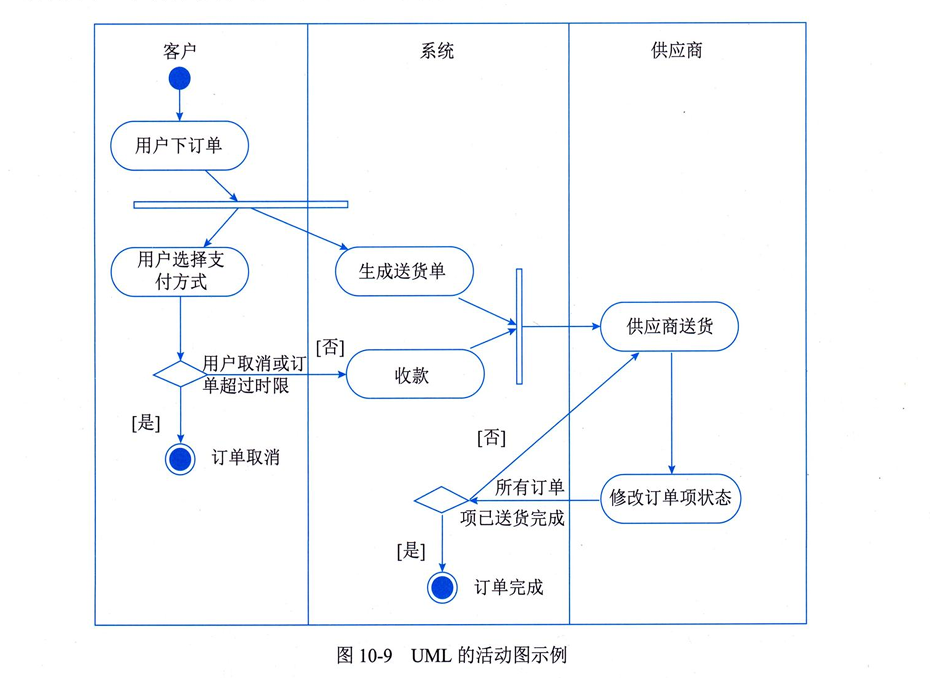
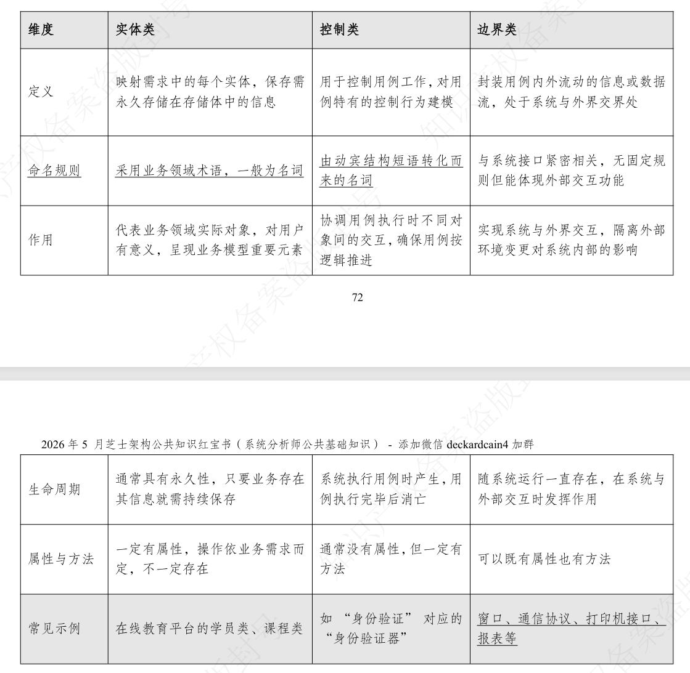

# 数据库
## 1.三级模式-两级映射
外模式对应用户看到的东西，对应数据库中的视图级别，比如select，可以有多种
概念模式（逻辑模式）：表级别（关系），1种情况（只能是表）
内模式：1种情况（物理文件）

外模式—（逻辑独立性/模式映像）—概念模式—（物理独立性/内模式映射）—内模式，两两之间相互映射

## 2.数据库设计
分为规划、需求分析、概念设计、逻辑设计和物理设计五个阶段。

阶段	做什么	产出物	是否关心具体数据库
需求分析	收集用户数据需求	数据流图、数据字典	不关心
概念设计	抽象出业务里"有什么实体、实体有什么关系"	E-R图	完全不关心，是DBMS无关的
逻辑设计	把E-R图转换成某种数据模型能实现的结构	关系模式（表结构定义，也可以是非关系型模型，包括键值存储、文档存储、图形存储等）	关心数据模型（关系/层次/网状），但不关心具体哪个DBMS产品
物理设计	定索引、存储方式、分区	存储结构、存取路径	关心具体DBMS（MySQL/PostgreSQL等）

逻辑设计的产出：不是ER图本身，而是关系模式——用关系模式表示法写出来的表结构。

关系模式是对关系数据库中一张表结构的完整描述，形式化表示为 R(U, D, DOM, F)，其中包含关系名、属性集合、属性所属域、属性到域的映射以及属性间的函数依赖。
关系模型中的一行是一个元组。

### 2.1 ER图
ER模型可转换为关系模型，其中每个实体对应一个关系模式。

带两条竖杠的实体称为子实体，它是实体的某种特例。
弱实体：依赖于强实体（正常实体）而存在。比如学生和紧急联系人之间的关系。是两个长方形框在一起的，也就是一个回形。
联系：用菱形表示。一对一、一对多和多对多三种情况。
属性：用椭圆表示。

### 2.2 关系代数（表之间的运算）（笛卡尔集、投影、选择，以及差集）
笛卡尔积（X）：m*n条，产生的结果包括m和n的所有属性列，最终产出m乘n个记录数，m加n个属性列。
自然连接（像是一个蝴蝶结的符号）：重复的列只显示一次，仅显示两个关系模式中属性相同且值相同的记录。且优先显示第一张表的属性。

投影（π，选属性，Name）：实际是按条件选择某关系模式中的某列，列也可以用数字表示。
从第一张表到第二张表的属性依次用1到n表示。

选择（σ，选记录,No）：实际是按条件选择某关系模式中的某条记录，可以选择，比如1=4，即第一个表的第1个属性等于 将两个表属性相加的第4个属性。

### 2.3 sql语句（from默认采用的是笛卡尔积）
Group后面只能跟having，不能跟where

### 2.4 范式和函数依赖
部分函数依赖（主键有多个）：主键是（A,B），可确定C。单独一个A也可确定C。
传递依赖：若A和B不等价时，A可确定B，B可确定C，则A可确定C。
候选键（能唯一标识此表的组合，去掉冗余的属性）
主属性（候选键内的属性都是主属性）

1NF第一范式（存在不分函数依赖）：每个属性都是不可分的。
2NF（存在传递函数依赖）：消除了非主属性对于主属性的部分函数依赖。
3NF（存在主属性之间的部分函数依赖）：消除了非主属性对于主属性的传递函数依赖。
BCNF：消除了主属性之间的部分函数依赖和传递函数依赖。
4NF：消除非平凡的多值依赖。

STC(学号 S, 课程 C, 教师 T)
4. 第三步：判定是否满足 BCNF
再次检查函数依赖 T → C：
箭头左边的决定因素是单个属性 T。
T 是候选码吗？不是（候选码是 (S, C) 和 (S, T)，T 只是候选码 (S, T) 的一部分）。
换言之，主属性 C 对候选码 (S, T) 产生了主属性之间的部分函数依赖。因此，STC(S, C, T) 不满足 BCNF！

异常类型	在 STC(学号 S, 课程 C, 教师 T) 中的具体表现
数据冗余	如果有 200 名学生选修了“张老师”教的“数据库原理”，那么 张老师 → 数据库原理 这一条对应关系会在表中重复存储 200 次。
插入异常	新入职的“李老师”被安排讲授“编译原理”，但目前尚未开放选课（即没有学号 S）。由于 S 是主属性不能为空（实体完整性约束），导致“李老师教编译原理”这一信息无法存入数据库。
删除异常	假如选修“王老师”讲授的“人工智能”课的唯一一名学生办理了退课，将该学生的选课记录删除后，“王老师讲授人工智能”这一教务信息也随之丢失了。
修改异常	若“张老师”改教“软件工程”，必须同时更新全部 200 条选课记录中的课程名，一旦漏改就会造成数据不一致。

# 1.系统规划与分析
系统分析阶段的基本任务是：系统分析师与用户充分了解、沟通需求后，将双方对新系统的理解呈现为系统需求规格说明书。书本上系统分析主要分为问题分析、业务流程分析、数据与数据流程分析、系统可行性分析、成本效益分析。

## 1.1业务流程分析
方法：价值链分析法、客户关系分析法、供应链分析法、基于ERP的分析法、业务流程重组。
工具：业务流程图/业务活动图
业务流程建模（BPM）：业务流程语言，可以分为文本类和图元类（UML，BPMN）。

UML（统一建模语言）用例图：主要用于业务流程建模。
构造块：包括事物、关系和图。

## 1.2系统可行性分析
经济可行性、技术可行性、法律可行性、用户使用可行性、进度可行性（从项目周期角度看）。

# 2.软件工程概述（选择题/论文题）
软件工程由（方法，工具和过程）三个部分组成。包括（PDCA）四方面，plan，do，check，action。
逆向工程：从低层（代码）推回高层设计。
抽象层次由低到高：实现级、结构级、功能级、领域级。
实现级：包括程序的抽象语法树/符号表等信息，最低级的抽象。
结构级：包括反映程序分量相互依赖关系的信息，如调用图、结构图等。
再工程：逆向工程+新需求+正向工程

## 2.1基于构建的软件工程（Component-BasedSoftwareEngineering，CBSE）（★★★★★）（超级重点，选择论文反复考）
CBSE旨在通过复用可重用的软件构件来构造高质量、高效率的应用软件系统。
构件的定义：可组装性、可部署性、文档化、独立性、标准化、可见性。
构件的分类：独立而成熟的构件（隐藏所有接口，数据库管理系统，操作系统）、有限制的构件（提供接口并指出使用条件和前提，python基础类库）、适应性构件（ActiveX组件）、装配的构件（office全家桶）、可修改的构件。

CBSE活动分为两块：一块是面向复用的开发，一块是基于复用的开发。
基于复用的开发，是复用已存在的构件和服务来开发新的应用程序，过程如下：
（1）系统需求概览；（2）识别候选构件；（3）根据发现的构件修改需求；（4）体系结构设计；
（5）构件定制与适配；（6）组装构件，创建系统。

组装方式：顺序组装（构件之间不相互调用，可能被外部程序调用），层次组装（一个调用另一个），叠加组装（新构件接口是原构件接口的组合）。
参数不兼容，操作不兼容，操作不完备。

## 2.2软件过程/生命周期模型（超级重点，选择案例反复考）
要经历从软件定义、软件开发、软件运行、软件维护（软件生命周期方法学），直到被淘汰的全过程。
对软件生命周期中的各项任务给予规程约束的工作模型，称为软件过程开发模型，有时也称为软件生命周期模型。
模型种类包括：
1. 在软件需求完全确定的情况下，使用瀑布模型。
瀑布模型的缺点是：依赖早期进行的需求调查，不能适应需求变化。软件需求的完整性、正确性等很难确定，甚至可能是不现实的。
2. 软件开发初始阶段仅能提供基本需求时，可以使用喷泉模型、螺旋模型、敏捷方法等。
原型模型、演化模型、快速原型模型等。

优点：可以在功能开发后及时测试，以验证需求。

缺点：若让用户过早接触不稳定功能，可能对开发或用户造成负面影响。

螺旋模型等于快速原型+风险分析（螺旋模型是在快速原型的基础上扩展而成），特别适用于庞大复杂并具有高风险的系统。

喷泉模型是一种以用户需求为动力、以对象为驱动的模型，主要用于描述面向对象的软件开发过程。喷泉模型的各个阶段可以交互进行。

V模型：需求分析、概要设计、详细设计、编码，到单元测试、集成测试、系统测试、验收测试。
单元测试的依据是软件详细设计说明书（因为里面有具体的功能说明）。
集成测试的依据是软件概要设计文档（集成测试测的是接口关系，所以需要概要设计文档）。
系统测试的依据是需求分析文档。
验收测试的依据是用户需求。

RUP（统一过程）
RUP是用例驱动的、以体系结构为中心的、迭代和增量的软件开发过程。
RUP的九大核心工作流分别是：业务建模、需求、分析与设计、实现、测试、部署、配置与变更管理、项目管理、环境。

敏捷方法★★★★★（XP极限编程、FDD，水晶系列方法、Scrum。）
敏捷方法是适应型，而非可预测型。其强调开发团队与用户之间的紧密协作，是一种以人为本的开发方式，也是一种迭代增量式的开发过程。
敏捷宣言认为：个体和交互胜过过程和工具，可工作的软件胜过大量文档，客户合作胜过合同谈判，响应变化胜过遵循计划。
适用于规模较小、快速改变的项目。
3. 以形式化开发方法为基础，可以使用变换模型。

# 3.软件过程管理
软件能力成熟度模型CMM：5个成熟度等级：初始级、可重复级、已定义级、已管理级和优化级。
能力成熟度模型集成CMMI：四大知识体系包括：系统工程、软件工程、集成产品与流程开发，以及供应商采购。

# 4.需求工程（★★★★★，选择案例论文）
软件需求工程是包括创建和维护软件需求文档所必须的一切活动的过程。
需求开发包括需求获取、需求分析、编写需求规格说明书和需求验证四个阶段。（货分归验）
需求管理包括需求基线、需求变更处理和需求跟踪等方面的工作。（基变跟）
需求获取包括用户访谈、问卷调查、采样、收集资料、获取文档、参加业务实践等方式。

## 4.1结构化分析方法/建模SA（★★★★★）
主要掌握数据流图的基本概念和图例。
结构化分析方法的基本思想是自顶向下、逐层分解，把一个大问题拆分成若干个小问题。
结构化分析方法中，分析模型的核心是数据字典。围绕这个核心，有三个层次的模型，分别是数据模型（ER图）、功能模型（DFD图）和行为模型（状态转换图）。

### 4.1.1 DFD图（★★★★★）
符号包括数据流（箭头），数据处理/加工（圆弧框），数据存储（三面围栏），外部实体（方框）
数据存储要被外部实体使用，必须要经过加工。

要掌握父子图的平衡和子图的平衡，并结合案例真题，能够找茬并写出错误原因。
几个子图内部平衡主要错误原因：
1.加工只有输入，没有输出。
2.加工只有输出，没有输入。
3.加工应该输出A，实际给出B。
4.只有读没有写，或者只有写没有读。

## 4.2面向对象分析方法/建模（★★★★★）（主要只考用例模型-用例图和分析模型-类图两块）
面向对象分析/建模方法：分为对象模型（类图表示）、动态模型（状态图）、功能模型（用例图）。
对象模式：从结构角度定义系统中有哪些对象，对象包含哪些属性，以及对象之间的关系。
动态模型：动态模型刻画系统或对象在时间维度上的行为变化，说明系统在什么状态下受到何种事件触发，会发生什么行为。通常通过状态图、顺序图等来描述。
功能模型：从用户和业务角度说明系统要做什么，描述系统对外提供的功能及其处理过程，常用数据流图或用例图表示。

对象模型为功能模型和动态模型提供结构基础，而功能模型和动态模型又从行为和时序角度补充对象模型。

### 4.2.1用例模型 ★★★★★★★★★★—（1. 识别参与者。2. 合并需求，获得用例。3. 细化用例描述。4. 调整用例模型。）必须背
用例模型：构建用例模型需要四个阶段，分别是：
1. 识别参与者：确定与系统交互的外部实体（如用户、外部系统等）及其角色。
2. 合并需求，获得用例：将用户需求整合为系统的核心业务场景（即用例），反馈参与者与系统的交互目标。
3. 细化用例描述：为每个用例补充详细的交互流程、前置条件、后置条件、异常处理等信息，明确系统行为。
4. 调整用例模型：优化用例之间的关系（如包含，扩展，泛化），确保模型结构清晰，无冗余，符合业务逻辑和系统设计目标。
用例图的元素中，重点记忆关联元素。关联关系一般作用于参与者和用例之间，用横线符号表示。
用例图中主要包括参与者（所有事物）、用例（事件）和通信关联（箭头）三种元素。

### 重点
1. 识别参与者：参与者是系统交互的所有事物，不仅可以由人担当，也可以是其他系统、硬件设备，甚至是系统时钟。参与者一定在系统之外，不是系统的一部分。
2. ★★★★★调整用例模型：

顺序图的4个种核心元素包括参与者、对象、生命线、消息。
参与者是指与系统发生交互的外部实体，既可以是人，也可以是系统或硬件设备。
对象是指系统内部承载具体业务逻辑的功能模块或者实体，通常对应面向对象设计中类的实例。其作用是执行核心业务操作，是消息传递的核心载体。
生命线是指从参与者或对象底部延伸出的纵向虚线，代表参与者或对象在时间维度上的存在周期。其作用是通过纵向时间轴来体现交互的先后顺序。
消息是指参与者与对象、对象与对象之间传递的交互指令，是顺序图中描述交互内容的核心元素。通过带箭头的线条来表示，箭头上方需标注消息名称。其作用是明确交互的具体内容与流向，串起整个业务操作的逻辑节点。

顺序图的侧重点是以时间顺序为核心，清晰展示对象之间消息传递的先后顺序，强调何时交互。适用场景是需要梳理复杂业务流程的时间逻辑。
协作图则侧重对象的关联。展示对象之间连接关系，强调谁与谁交互，并通过序号来表示消息传递顺序。

### 4.2.2分析模型（类图） ★★★★★★★★★★—（1. 定义概念类，2.确定类之间的关系，3.为类添加职责，4.建立交互图）必须背
如何建立某某系统的分析模型？前三个步骤统称为类-责任-协作者，CRC建模。聚焦明确类的定义、职责及与其他类的协作关系，是构建类模型的基础，后续建立交互图，重点展现类实例在预约、核验等业务流程中的动态交互过程，确保模型贴合业务需求。

分析模型描述系统的基本逻辑结构，展示对象和类如何组成系统，以及它们如何保持通信并实现系统行为。步骤包括CRC建模。即类——责任——协作者。
类之间的关系有关联、依赖、泛化、聚合、组合和实现等六大关系。
实体类：映射需求中的每个实体，一般为名词，有属性，不一定有操作。作用：持久化保存实体信息，通常对应数据库中的数据表。

控制类：用于控制用例工作，一般为动宾短语，一般无属性，必有方法。作用：协调用例中不同对象的交互，保障业务流程完成。如预约管理类，伴随用例执行完毕而消亡。

边界类：位于系统与外界交界处，包括界面，接口等，是参与者与系统交互的媒介。作用：实现系统与外界交互，隔离外部环境变更对系统内的影响。

## 4.3建模语言（★★★★★）
### 4.3.1 UML建模语言（★★★★★）
UML的结构包括构造块、规则和公共机制三个部分。
公共机制包括四大要素：详述，通过文字补充。修饰，利用附加符号。通用划分：基于类或对象的二分法，抽象系统层次。扩展机制通过构造型、标记值和约束，支持建模元素的自定义扩展。

## 4.4需求管理（★★★★★）
需求管理要求掌握的是变更管理、风险管理和需求跟踪。
需求风险管理。带有风险的做法列举如下，如：
1. 无足够用户参与。
2. 忽略了用户分类。
3. 用户需求的不断增加。
4. 模棱两可的需求。
5. 不必要的特性。
6. 过于精简的SRS(软件需求规格说明书)。
7. 不准确的估算。

# 5.系统设计（★★★★★）
系统设计它不单单包括概要设计，还包括具体构建系统的详细设计方案和相关模型。
概要设计是对系统进行高层次的规划和设计；
详细设计则是对系统中各个模块的具体实现方式进行确定；

## 5.1工作流管理系统
工作流管理系统（WFMS）是将流程从“纸面上的设计”落到“可执行、可监控的系统化管理”中的关键纽带。
WFMS 基本功能包括对工作流建模（定义活动和规则，对应现实业务处理过程）、工作流执行（创建和执行实际工作流）、业务过程管理和分析（监控管理执行中的业务情况）。

## 5.1面向对象设计（★★★★★★★★★★）
面向对象设计（OOD）是面向对象分析（OOA） 方法的延续，其基本思想包括抽象、封装和可扩展性，其中可扩展性主要通过继承和多态
来实现。在面向对象设计中，数据结构上定义的操作算法封装在一个对象之中。

### 5.1.1设计类分类（★★★★★）

实体类：映射需求中的每个实体，一般为名词，有属性，不一定有操作。作用：持久化保存实体信息，通常对应数据库中的数据表。
控制类：用于控制用例工作，一般为动宾短语，一般无属性，必有方法。作用：协调用例中不同对象的交互，保障业务流程完成。如预约管理类，伴随用例执行完毕而消亡。
边界类：位于系统与外界交界处，包括界面，接口等，是参与者与系统交互的媒介。作用：实现系统与外界交互，隔离外部环境变更对系统内的影像。

​
### 5.1.2面向对象设计原则（★★★★★）
SOLID原则：
单一职责原则，开闭原则，里氏替换原则，接口隔离原则，依赖倒置原则。
S：一个类或一个模块只做一件事；
O：对扩展开放，对修改关闭；一个类独立以后就不应该去修改它，而是以扩展适应新需求；
L：所有基类出现的地方都可以用派生类替换而不出错（派生类一定属于基类的特例），派生类可以扩展基类功能，不能改变原有功能；
I：一个接口应该拥有尽可能少的行为，使其精简单一。对于不同功能的模块使用不同接口。
D：高级模块不应依赖低级模块，而是依赖抽象接口，通过抽象接口使用对应的低级模块。

### 5.1.3结构化设计（★★★★★）
软件设计模型/结构化设计——包括四个既独立又相互联系的活动——数据设计、软件结构设计、人机界面设计（接口设计）和过程设计。
模块划分原则：模块大小适中，模块扇入扇出合理，深度和宽度适当，信息隐蔽即可。
“高内聚、低耦合”的设计原则。

# 6.系统架构设计

